# PackRight Follow-ups

A lead follow-up agent with a working web app on top, built for a packaging-equipment company with five sales reps. It reads each lead's WhatsApp chat, tags the lead **Hot / Warm / Cold** with a one-line reason, sets the next follow-up date, and drafts the next message. The screen tells each rep who to follow up with today and what to say.

**Live:** [gushwork-sooty.vercel.app](https://gushwork-sooty.vercel.app) (mirror: [gushwork-production.up.railway.app](https://gushwork-production.up.railway.app)) · **Design notes:** [NOTE.md](NOTE.md) · **Decision log:** [DECISIONS.md](DECISIONS.md)

## What it does

| For the rep | How |
|---|---|
| See who to follow up with, most urgent first | Four views: **Overdue** (in red), **Due today**, **Upcoming**, **Done today**. Hot leads first, then the most days late. |
| Know why a lead is Hot, Warm or Cold | The lead sheet shows the one-line reason and a score ledger ("How was this scored?") with the quote behind each point. |
| Send the next message | A WhatsApp-style draft is ready. Edit it, copy it, or **Mark as sent**. Unknown prices and dates are left as `[placeholders]` and block sending until filled. |
| Keep the lead up to date | **Add chat** (paste a WhatsApp export or a single message) or **Add lead**. The agent re-tags the lead and re-plans the follow-up straight away. |
| Find a lead fast | `Cmd/Ctrl + K` search by name, company or phone. Filter by rep. |

A lead counts as **Done today** when the rep's own message is the newest one in the chat and was sent today (IST). A buyer reply after that sends it back to the queue.

## How the agent decides

The language model reads the chat. Plain code makes the decisions. That keeps tags consistent and explainable.

1. **Extract signals (LLM).** From the chat and CRM notes it fills yes/no signals, each with a supporting quote: strong intent, medium intent, open request, pending promise from the rep, time pressure, unresolved price objection, deferred, lost.
2. **Score and tag (code, `lib/agent/score.ts`).**

   | Signal | Points | | Signal | Points |
   |---|---|---|---|---|
   | Strong intent (quote, demo, visit, trial, proforma) | +35 | | Price objection unresolved | −10 |
   | Medium intent | +25 | | No reply to our follow-ups | −15 |
   | Buyer waiting on us | +20 | | Deferred to a later time | −25 |
   | We owe them something | +15 | | Active in the last 3 days | +10 |
   | Deadline mentioned | +10 | | Quiet 11–20 days / silent 21+ | −5 / −20 |

   **50 or more is Hot, 20–49 is Warm, below 20 is Cold.** A lead the buyer has dropped ("lost") is always Cold.
3. **Pick the follow-up date (code, `lib/agent/schedule.ts`).** The buyer's own date wins, then "buyer is waiting" (today), then our pending promise (the day after our last message), then Hot +1 day, Warm +3, Cold +14. Sundays are skipped.
4. **Write the reason and the draft (LLM).** It is told the tag, the score and who owes what, and must never invent a price or a date.

On the 16 hand-labelled leads, `pnpm eval` gives 16/16 tags and 10/10 dates. The prompt was tuned on those same leads, so treat that as in-sample (see D-18 in `DECISIONS.md`).

## Architecture

```mermaid
%% Generated by https://gitdiagram.com/divyam19/gushwork
flowchart TD

subgraph group_dashboard["Rep dashboard"]
  node_dashboard["Follow-up dashboard<br/>[page.tsx]"]
  node_lead_list["Lead queue<br/>[lead-list.tsx]"]
  node_lead_sheet["Lead detail<br/>[lead-sheet.tsx]"]
  node_chat_thread["Chat thread<br/>[chat-thread.tsx]"]
  node_draft_editor["Draft editor<br/>[draft-editor.tsx]"]
  node_rep_switcher["Rep filter<br/>[rep-switcher.tsx]"]
  node_view_nav["Queue views<br/>[view-nav.tsx]"]
  node_search["Lead search<br/>[search-palette.tsx]"]
  node_add_lead["Add lead"]
  node_add_chat["Add chat"]
end

subgraph group_api["Lead operations"]
  node_leads_api["Lead creation<br/>[route.ts]"]
  node_messages_api["Message operations<br/>[route.ts]"]
  node_analyze_api["Analysis endpoint<br/>[route.ts]"]
  node_draft_api["Draft endpoint<br/>[route.ts]"]
  node_send_api["Send logging<br/>[route.ts]"]
  node_reseed_api["Demo reset<br/>[route.ts]"]
end

subgraph group_analysis["Lead analysis"]
  node_agent_run["Analysis orchestrator<br/>[run.ts]"]
  node_extract["Signal extraction<br/>[extract.ts]"]
  node_prompts["Analysis prompts<br/>[prompts.ts]"]
  node_score["Lead scoring<br/>[score.ts]"]
  node_schedule["Follow-up scheduling<br/>[schedule.ts]"]
  node_writer["Reason and draft<br/>[write.ts]"]
  node_llm_client["Structured LLM client<br/>[llm.ts]"]
end

subgraph group_data["Persistence and integrations"]
  node_lead_service["Lead queries<br/>[leads.ts]"]
  node_queue["Queue builder<br/>[queue.ts]"]
  node_messages["Message helpers<br/>[messages.ts]"]
  node_parser["WhatsApp parser<br/>[whatsapp-parser.ts]"]
  node_schemas["Domain schemas<br/>[schemas.ts]"]
  node_dates["IST date rules<br/>[dates.ts]"]
  node_db_client["Database client<br/>[db.ts]"]
  node_seed["Seed data<br/>[seed.ts]"]
end

node_rep(("Sales rep"))
node_supabase[("Supabase")]
node_openai(("OpenAI"))

node_rep -->|"reviews leads"| node_dashboard
node_dashboard -->|"loads data"| node_lead_service
node_dashboard -->|"builds queue"| node_queue
node_dashboard -->|"renders"| node_lead_list
node_dashboard -->|"opens detail"| node_lead_sheet
node_dashboard -->|"renders"| node_rep_switcher
node_dashboard -->|"renders"| node_view_nav
node_lead_sheet -->|"renders"| node_chat_thread
node_lead_sheet -->|"renders"| node_draft_editor
node_lead_sheet -->|"renders"| node_add_chat
node_rep -.->|"finds leads"| node_search
node_rep -.->|"enters lead"| node_add_lead
node_add_lead -->|"parses chat"| node_parser
node_leads_api -->|"analyzes lead"| node_agent_run
node_leads_api -->|"writes lead"| node_db_client
node_leads_api -->|"formats messages"| node_messages
node_messages_api -->|"reanalyzes lead"| node_agent_run
node_messages_api -->|"uses helpers"| node_messages
node_analyze_api -->|"runs analysis"| node_agent_run
node_draft_api -->|"accesses data"| node_db_client
node_send_api -->|"reanalyzes lead"| node_agent_run
node_send_api -->|"accesses data"| node_db_client
node_reseed_api -->|"resets demo"| node_seed
node_lead_service -->|"queries data"| node_db_client
node_lead_service -->|"uses queue types"| node_queue
node_agent_run -->|"loads and saves"| node_db_client
node_agent_run -->|"extracts signals"| node_extract
node_agent_run -->|"scores signals"| node_score
node_agent_run -->|"sets follow-up"| node_schedule
node_agent_run -->|"writes draft"| node_writer
node_agent_run -->|"uses IST dates"| node_dates
node_extract -.->|"formats input"| node_prompts
node_writer -->|"uses prompts"| node_prompts
node_writer -->|"requests generation"| node_llm_client
node_llm_client -->|"calls API"| node_openai
node_db_client -->|"connects"| node_supabase
node_seed -->|"writes seed data"| node_db_client
node_agent_run -->|"uses domain types"| node_schemas
node_score -->|"uses domain types"| node_schemas
node_schedule -.->|"uses domain types"| node_schemas

click node_dashboard "https://github.com/divyam19/gushwork/blob/main/app/page.tsx"
click node_lead_list "https://github.com/divyam19/gushwork/blob/main/components/lead-list.tsx"
click node_lead_sheet "https://github.com/divyam19/gushwork/blob/main/components/lead-sheet.tsx"
click node_chat_thread "https://github.com/divyam19/gushwork/blob/main/components/chat-thread.tsx"
click node_draft_editor "https://github.com/divyam19/gushwork/blob/main/components/draft-editor.tsx"
click node_rep_switcher "https://github.com/divyam19/gushwork/blob/main/components/rep-switcher.tsx"
click node_view_nav "https://github.com/divyam19/gushwork/blob/main/components/view-nav.tsx"
click node_search "https://github.com/divyam19/gushwork/blob/main/components/search-palette.tsx"
click node_add_lead "https://github.com/divyam19/gushwork/blob/main/components/add-lead-dialog.tsx"
click node_add_chat "https://github.com/divyam19/gushwork/blob/main/components/add-chat-dialog.tsx"
click node_leads_api "https://github.com/divyam19/gushwork/blob/main/app/api/leads/route.ts"
click node_messages_api "https://github.com/divyam19/gushwork/blob/main/app/api/leads/%5Bid%5D/messages/route.ts"
click node_analyze_api "https://github.com/divyam19/gushwork/blob/main/app/api/leads/%5Bid%5D/analyze/route.ts"
click node_draft_api "https://github.com/divyam19/gushwork/blob/main/app/api/leads/%5Bid%5D/draft/route.ts"
click node_send_api "https://github.com/divyam19/gushwork/blob/main/app/api/leads/%5Bid%5D/send/route.ts"
click node_reseed_api "https://github.com/divyam19/gushwork/blob/main/app/api/cron/reseed/route.ts"
click node_lead_service "https://github.com/divyam19/gushwork/blob/main/lib/leads.ts"
click node_queue "https://github.com/divyam19/gushwork/blob/main/lib/queue.ts"
click node_messages "https://github.com/divyam19/gushwork/blob/main/lib/messages.ts"
click node_parser "https://github.com/divyam19/gushwork/blob/main/lib/whatsapp-parser.ts"
click node_agent_run "https://github.com/divyam19/gushwork/blob/main/lib/agent/run.ts"
click node_extract "https://github.com/divyam19/gushwork/blob/main/lib/agent/extract.ts"
click node_prompts "https://github.com/divyam19/gushwork/blob/main/lib/agent/prompts.ts"
click node_score "https://github.com/divyam19/gushwork/blob/main/lib/agent/score.ts"
click node_schedule "https://github.com/divyam19/gushwork/blob/main/lib/agent/schedule.ts"
click node_writer "https://github.com/divyam19/gushwork/blob/main/lib/agent/write.ts"
click node_schemas "https://github.com/divyam19/gushwork/blob/main/lib/schemas.ts"
click node_dates "https://github.com/divyam19/gushwork/blob/main/lib/dates.ts"
click node_db_client "https://github.com/divyam19/gushwork/blob/main/lib/db.ts"
click node_llm_client "https://github.com/divyam19/gushwork/blob/main/lib/llm.ts"
click node_seed "https://github.com/divyam19/gushwork/blob/main/lib/seed.ts"

classDef toneNeutral fill:#f8fafc,stroke:#334155,stroke-width:1.5px,color:#0f172a
classDef toneBlue fill:#dbeafe,stroke:#2563eb,stroke-width:1.5px,color:#172554
classDef toneAmber fill:#fef3c7,stroke:#d97706,stroke-width:1.5px,color:#78350f
classDef toneMint fill:#dcfce7,stroke:#16a34a,stroke-width:1.5px,color:#14532d
classDef toneRose fill:#ffe4e6,stroke:#e11d48,stroke-width:1.5px,color:#881337
classDef toneIndigo fill:#e0e7ff,stroke:#4f46e5,stroke-width:1.5px,color:#312e81
classDef toneTeal fill:#ccfbf1,stroke:#0f766e,stroke-width:1.5px,color:#134e4a
class node_dashboard,node_lead_list,node_lead_sheet,node_chat_thread,node_draft_editor,node_rep_switcher,node_view_nav,node_search,node_add_lead,node_add_chat toneBlue
class node_leads_api,node_messages_api,node_analyze_api,node_draft_api,node_send_api,node_reseed_api,node_supabase toneAmber
class node_agent_run,node_extract,node_prompts,node_score,node_schedule,node_writer,node_llm_client toneMint
class node_lead_service,node_queue,node_messages,node_parser,node_schemas,node_dates,node_db_client,node_seed toneRose
class node_rep,node_openai toneIndigo
```



The diagram has four layers, from top to bottom:

- **Rep dashboard (blue).** The screen. `page.tsx` loads every lead, builds the queue, and renders the list, the view tabs, the rep filter and the lead sheet. The sheet holds the chat, the draft editor and Add chat. Add lead parses a pasted WhatsApp export on the client.
- **Lead operations (amber).** Next.js API routes. Creating a lead, adding a chat, pressing Regenerate and Mark as sent all end in the analysis orchestrator, so the lead is re-tagged right away. `draft` only saves edits. `reseed` is the manual demo reset.
- **Lead analysis (green).** The agent. `run.ts` calls the model to extract signals (`extract.ts`), then plain code scores them (`score.ts`) and picks the date (`schedule.ts`), then the model writes the reason and draft (`write.ts`). All model calls go through one structured-output client (`llm.ts`) that validates the reply against a zod schema.
- **Persistence and shared code (rose).** Supabase access (`db.ts`, `leads.ts`), the queue builder (`queue.ts`), shared types (`schemas.ts`), India-time date rules (`dates.ts`), the WhatsApp parser, and the seeder. The Supabase service key is only ever used on the server.

## Tech stack

Next.js 16 (App Router, TypeScript) · React 19 · Tailwind CSS v4 · shadcn/ui · Motion · Supabase (Postgres) · OpenAI (`gpt-4o-mini` by default) · zod · date-fns-tz (Asia/Kolkata) · Vitest · pnpm

## Getting started

```bash
pnpm install
cp .env.example .env.local        # fill in the values below
# run supabase/schema.sql in your Supabase project's SQL editor
pnpm seed                         # 25 leads, 12 chats; dates are shifted so "today" is today (IST)
pnpm dev                          # http://localhost:3000
```

| Variable | Purpose |
|---|---|
| `SUPABASE_URL`, `SUPABASE_SERVICE_ROLE_KEY` | Database access. Server-side only, never sent to the browser. |
| `OPENAI_API_KEY`, `OPENAI_MODEL` | The model used for signal extraction and drafting (default `gpt-4o-mini`). |
| `CRON_SECRET` | Bearer token required by `/api/cron/reseed`. |

## Scripts

| Command | What it does |
|---|---|
| `pnpm dev` / `pnpm build` / `pnpm start` | Run, build, serve |
| `pnpm test` | Unit tests: scoring, scheduling, queue, WhatsApp parser, status rules (no network) |
| `pnpm eval` | Runs the agent on the 16 hand-labelled leads and prints tag and date pass/fail (calls OpenAI) |
| `pnpm seed` | Resets the database from `mock-data/` and a frozen analysis fixture. `--refresh` re-runs the model (about 25 calls). |
| `pnpm lint` | ESLint |

## Project layout

```
app/                 page and API routes (leads, messages, analyze, draft, send, reseed)
components/          dashboard UI (queue, lead sheet, draft editor, dialogs, search)
lib/agent/           extract, score, schedule, write, run (the agent)
lib/                 queue, leads, messages, schemas, dates, db, llm, seed, whatsapp-parser
mock-data/           sample leads, chats, hand labels, frozen analyses
supabase/schema.sql  database tables
tests/               unit tests
```

## Deployment

Deploys as a standard Next.js app (Vercel and Railway both work). Set the five environment variables above. There is no scheduled reseed, so reviewers' edits persist; to reset the demo and re-anchor dates to today, run `pnpm seed` or call `/api/cron/reseed` with `Authorization: Bearer $CRON_SECRET`.

## Scope and limitations

- **No login, by design.** Reps are chosen in the UI, so the write and model routes are open to anyone with the URL. Put the deployment behind a password or deployment protection before sharing it widely.
- **No real WhatsApp sending.** Reps copy the draft and paste chats in by hand.
- **One owner per lead**, no reassignment.
- **The agent runs inline** in the request (about 3–6 seconds) rather than through a queue.

See [NOTE.md](NOTE.md) for the build summary and what would come next.
